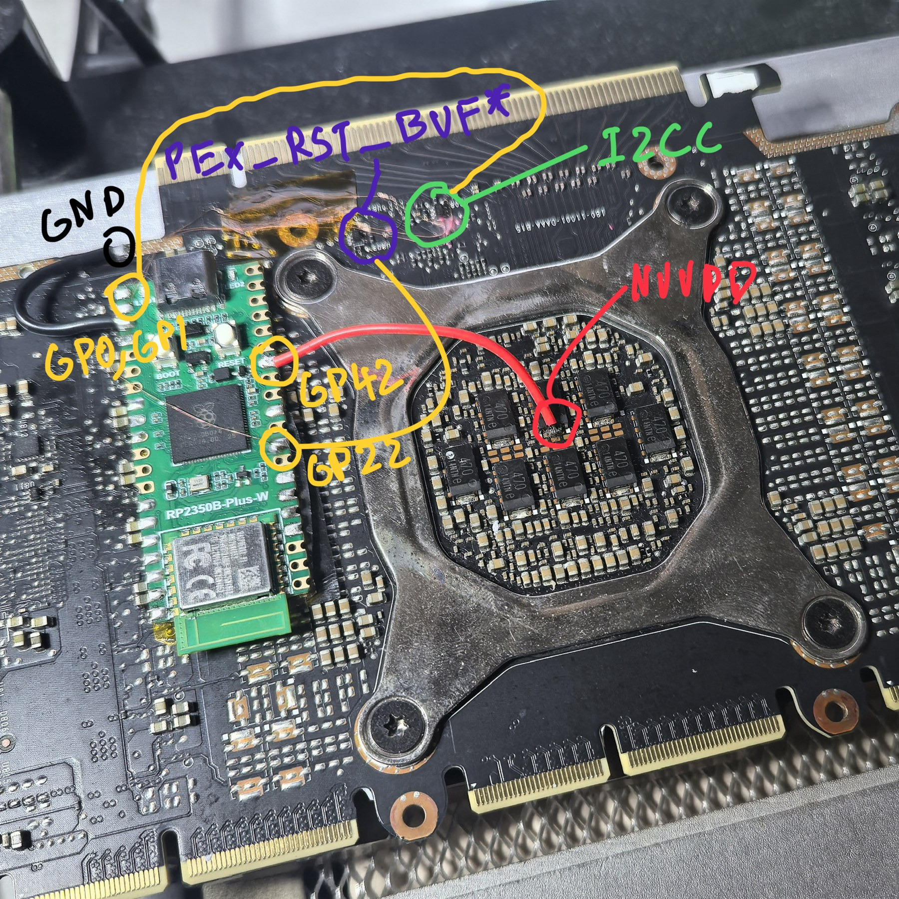
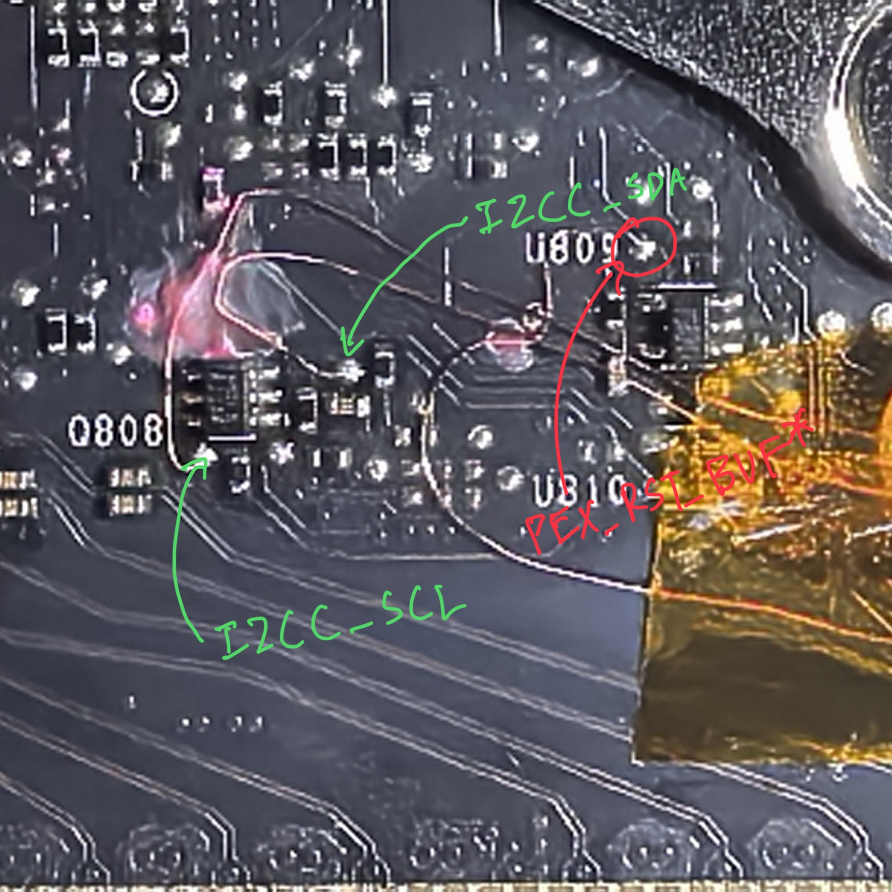
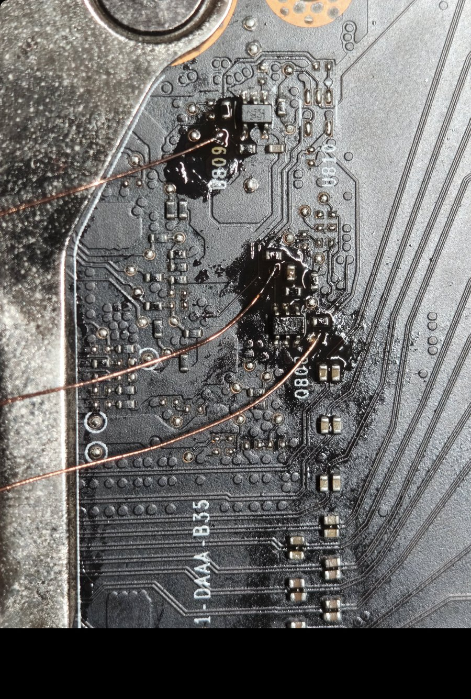
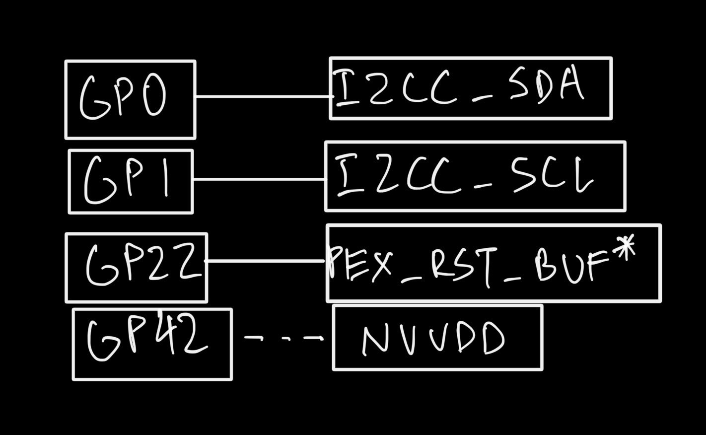
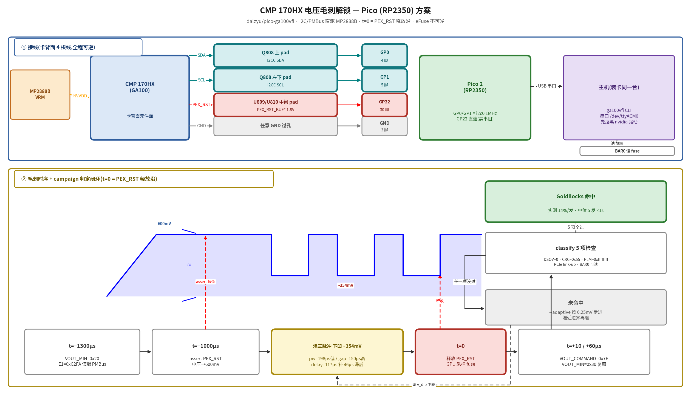
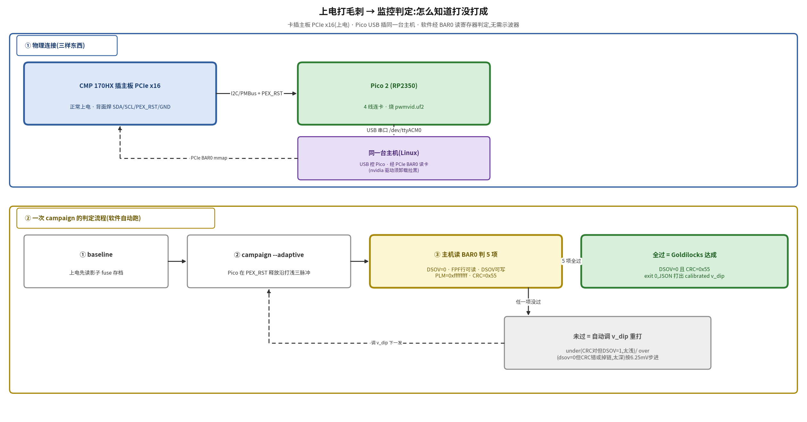
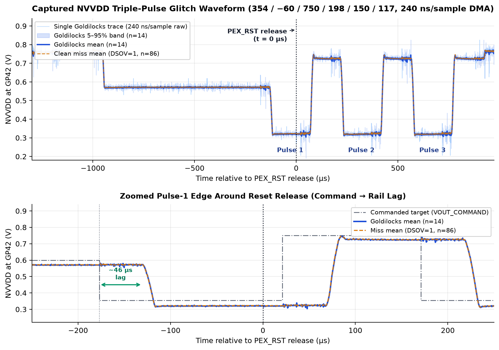

# CMP 170HX (GA100) 从 0 到全解锁 · 完整实操手册

本项目汇总社区与 QQ 群各位大佬实操破解的资料,梳理成图文教程。
打毛刺 → 烧 FF → 软件层主流程已在真实卡端到端跑通(2026-11-15 实测,见各阶段记录);阶段 6 转 A100 亦实测跑通(2026-11-16)。
欢迎各位实操过的大佬查漏补缺。


> 打包/部署见 [`部署清单.md`](部署清单.md)。

## 目录结构

| 路径 | 作用 |
|---|---|
| `README.md`(本文件) / `部署清单.md` | 实操手册 + 部署清单 |
| `utils/ga100_ff.py` | FF 解锁一体工具(plan/burn/verify,内置安全护栏) |
| `utils/ff_env_setup.py` | 主机侧环境准备(工具链/pico-sdk/固件编译/BOOTSEL 烧写/host CLI) |
| `utils/ff_burn_flow.py` | 主机侧一键流程编排(阶段 0.2→3 自动推进,断点续跑) |
| `images/` | 手册配图 + spec 图源 + `render_spec.py` 渲染脚本 |
| `pico-ga100vfi/` ⊂ | RP2350 打毛刺固件 + host CLI |
| `ga100vfi/` ⊂ | 寄存器地图 + gpu0-capture |
| `cmp170hx-ffcalc/` ⊂ | 逐卡 FF 计算(交叉验证用) |
| `cmp-170hx-rir-burn-util/` ⊂ | CMD_WRITE 写机制参考 |
| `cmpunlocker/` | 80GB 显存几何 + PCIe 补丁(须配 nvidia-open 615.71.09) |
| `CMPGlitch/` | 完整记录快照:Gen4 跑通方案 + 备份/回滚工具链(驱动 610.43.03) |

> ⊂ = git submodule(见 `.gitmodules`),克隆后 `git submodule update --init` 拉取;日常更新用 `git submodule update --remote`。
> ffcalc issue#1 防护已由上游 `ad45868` 起原生实现(ffrows.py 全量覆盖检查 + REFUSED 拒绝出计划),无需再打补丁;历史补丁见 `utils/ffcalc-fix-issue1.patch`(已废弃)。
> `open-gpu-kernel-modules-615.71.09.tar.gz`(25M)不入库,克隆后手动放回根目录与 `cmpunlocker/driver/.build/`。

---

> 对象:CMP 170HX(8GB 版实际板载 ~80GB HBM,70 SM,PCIe Gen1)。
> 目标:**81920 MiB 显存 / 126 SM / PCIe Gen4 能力 / NVLink**。
> 本手册 = 实物接线 + 打毛刺 + 逐卡计算 + 烧 FF + 驱动层,端到端已在真实卡跑通(2026-11-15)。
> ⛔ **FF 烧写物理不可逆,烧错即报废。每个阶段都有"验证关",不过关不进下一阶段。**
> 阅读方式:按阶段顺序做;每阶段末有"✅ 达成判据",满足才继续。

**最速路径(懒人版)**:环境 + 全流程各一条命令,见 [阶段 −1 一键环境准备](#阶段-1--准备硬件软件环境) 与 [阶段 3.4 一键烧录流程](#34-一键流程可选utilsff_burn_flowpy):
```bash
python3 utils/ff_env_setup.py check                     # ① 环境检测(无 root)
sudo python3 utils/ff_env_setup.py all --board pico2_w  # ② 环境全装+编固件+烧 Pico
sudo python3 utils/ff_burn_flow.py run --bdf 0000:2f:00.0 --single  # ③ 打毛刺→…→烧完
```

## 目录

- [目录结构](#目录结构)
- [阶段 −1 · 准备(硬件/软件/环境)](#阶段-1--准备硬件软件环境)
- [阶段 0 · 接线 + 打毛刺进 Goldilocks](#阶段-0--接线--打毛刺进-goldilocks)
  - [0.2 主机准备(卸驱动)](#02-主机准备关键否则读不到卡)
  - [0.3 打金窗](#03-打金窗)
- [阶段 1 · 只读采集 + 逐卡算 FF 计划](#阶段-1--只读采集--逐卡算-ff-计划)
- [阶段 2 · 烧前预演(强制 dry-run)](#阶段-2--烧前预演强制-dry-run)
- [阶段 3 · 拿烧写权限(arm)+ 物理烧 FF(永久!)](#阶段-3--拿烧写权限arm-物理烧-ff永久)
  - [3.0 烧前备份](#30-烧前备份强烈建议cmpglitch-经验)
  - [3.3 血泪红线](#33-血泪红线实测踩坑)
  - [3.4 一键流程(ff_burn_flow.py)](#34-一键流程可选utilsff_burn_flowpy)
- [阶段 4 · 断电冷启 + 功能验收](#阶段-4--断电冷启--功能验收)
- [阶段 5 · 软件层:满血显存 + 实链提速](#阶段-5--软件层满血显存--实链提速)
  - [5.1 满血 80GB 显存](#51-满血-80gb-显存)
  - [5.2 PCIe 实链(Gen3/Gen4)](#52-pcie-实链gen3gen4)
  - [5.3 NVLink](#53-nvlink可选)
- [阶段 6 · 转 A100 80GB PCIe(可选,高风险)](#阶段-6--转-a100-80gb-pcie可选高风险)
  - [6.0 原理](#60-原理boot-gate-比的是熔丝-devid不是vbios-devid)
  - [6.1 前置条件](#61-前置条件缺一不可)
  - [6.2 流程](#62-流程3-个必做--2-个检查点同一开机周期干完)
  - [6.3 坑速查](#63-坑速查按杀伤力)
  - [6.4 残留](#64-残留a100-转换--全功能-a100)
  - [6.5 回退](#65-回退卡本身从没-brick)
- [附录 A · 持久性速查](#附录-a--持久性速查)
- [附录 B · 坑速查](#附录-b--坑速查)
- [附录 C · 权威来源](#附录-c--权威来源)

---

## 阶段 −1 · 准备(硬件/软件/环境)

### 目的
把"打毛刺 + 读卡 + 写 fuse + 驱动"所需的软硬件全部备齐。

### 硬件清单
| 项 | 说明 |
|---|---|
| CMP 170HX 显卡 | 8GB 版才有 80GB 潜力(10GB 版目标 40GB) |
| Raspberry Pi Pico 2 / 2 W / Waveshare Plus-W | RP2350,打毛刺用 |
| 漆包线/跳线 ×4 | 18–20AWG,镀锡头 |
| 烙铁 + 助焊剂 + 放大镜 | 焊卡背面 4 个点 |
| Linux 主机 | 装这张卡、能 sudo;**根端口决定 PCIe 上限**(要 Gen4 需主板/插槽支持) |

### 软件/工具链(在主机上装)
```bash
# 固件编译
pico-sdk                                   # 编 Pico 固件
# 只读采集/计算
rust toolchain                             # 编 gpu0-capture(可选)
python3 + pip                              # ffcalc
gcc make linux-headers-$(uname -r)         # 编 ffprobe.ko 采集模块
```
- 仓库(已备齐,submodule):`pico-ga100vfi`(打毛刺)、`cmp170hx-ffcalc`(算计划,issue#1 防护已入上游)、`cmp-170hx-rir-burn-util`(写机制参考)、`ga100vfi`(寄存器地图)。
- **一键环境准备**(apt 工具链 → pico-sdk → 固件编译 → BOOTSEL 烧写 → host CLI,幂等):
  ```bash
  python3 utils/ff_env_setup.py check                    # 只检测(无需 root)
  sudo python3 utils/ff_env_setup.py all --board pico2_w # 全流程(板型必填:pico2_w/pico2)
  ```
- **cmpunlocker**(软件层显存/PCIe)+ nvidia-open **615.71.09** 驱动(⚠️ 别用 615.78.08)。

### ✅ 达成判据
- 硬件在手;Pico 能进 BOOTSEL;主机能 `lspci | grep -i nvidia` 看到卡(PCI ID `10de:20c2`)。

---

## 阶段 0 · 接线 + 打毛刺进 Goldilocks

> 目的:**临时**让 fuse 控制器在这次 boot 把控制行读成全 0 → `DSOV=0`(software override 解锁)。
> ⚠️ 这是**易失**状态,断电/PEX_RST 即丢;只用于"读 fuse + 拿烧写权限",不是最终解锁。

### 0.1 接线(卡背面 4 根线,可逆)
| 信号 | 卡上焊点 | Pico 脚 |
|---|---|---|
| I2CC **SDA** | **Q808 上方的 pad** | **GP0**(物理 4 脚) |
| I2CC **SCL** | **Q808 左下的 pad** | **GP1**(物理 5 脚) |
| **PEX_RST** | **U809/U810 中间 pad** | **GP22**(物理 30 脚) |
| **GND** | 任意 GND 过孔 | **GND**(物理 3 脚) |

**实物接线总览**(Pico 平放卡面,USB-C 朝下;4 根线连到卡背面):



**焊点特写**(Q808 的 SDA/SCL,U809/U810 的 PEX_RST):






**接线示意**(信号流向):



**接线与时序框图**:



**红线:** PEX_RST **直连禁串电阻**(1.8V push-pull);固件只拉低不驱高;每焊点 ≤2 秒;不焊 NVVDD(正常编译用不到);全程可逆。

### 0.2 主机准备(关键,否则读不到卡)
```bash
# 按依赖顺序卸驱动(lightdm/lactd 会抢回,需先停)
sudo systemctl stop lightdm lactd; sudo pkill -x Xorg
sudo modprobe -r nvidia_uvm nvidia_drm nvidia_modeset nvidia
# 禁用会强装驱动的 install 规则(若有)
sudo mv /etc/modprobe.d/cmp-preflight.conf{,.disabled} 2>/dev/null
# 拉黑(aa- 前缀排最前)
sudo tee /etc/modprobe.d/aa-blacklist-nvidia-campaign.conf <<EOF
blacklist nvidia
blacklist nvidia_drm
blacklist nvidia_modeset
blacklist nvidia_uvm
install nvidia /bin/false
EOF
```

### 0.3 打金窗
```bash
pip install -e pico-ga100vfi/host/
sudo env PYTHONPATH=$PWD/host python3 -m ga100vfi campaign \
  --bdf 0000:2f:00.0 --adaptive --budget 500 --restore-wait 0.4
# --bdf 换成你的卡地址;--budget 为总发数上限(默认 500,无 0=无限)
```
工具自动:在 PEX_RST 释放沿打浅三脉冲 → 读 BAR0 判 5 项 → 没过按 6.25mV 调 `v_dip` 重打。实测中位 ~5–16 发、几秒即中。

**打毛刺→判定流程**(软件自动闭环,无需示波器):



**实测三脉冲波形**(命令→电压滞后约 46µs,已用 delay 补偿;来自 Kate 单卡 100 发实测):



### ✅ 达成判据(Goldilocks)
终端打出 `"passed": true`,且:
```
DSOV_STATUS  0x00820084 == 0        ← 金窗核心
CRC_STATUS   0x00820070 == 0x55
PRIV_MASK    == 0xffffffff           ← PLM 全开
FPF 行可读 / DSOV 可写回
```
> 只到这一步**断电就回到原样**,不产生任何永久改变。

---

## 阶段 1 · 只读采集 + 逐卡算 FF 计划

> 目的:读出**这张卡自己**的 fuse 现状和缺陷掩码,算出"该烧哪几行、烧什么值"。**只读,不改卡。**
> 用本目录一体工具 `utils/ga100_ff.py`(内置 issue#1 防呆 + 按本卡缺陷算目标)。

```bash
# 设 PYTHONPATH 指向 pico-ga100vfi 的 host(工具靠它读卡)
export PYTHONPATH=$PWD/pico-ga100vfi/host
sudo python3 utils/ga100_ff.py plan --bdf 0000:2f:00.0 -o plan.json
```
工具做:读金窗状态 + 全部 FF 物理行(222–487) + 本卡 `_DEFECTIVE` 缺陷掩码 → 按"**目标=缺陷(只禁真坏的)**"算出每条 FF 记录,从已用行之后追加空白行。**只读,不写。**

> ⚠️ 若 `plan.json` 里 `ff_rows` 为空(没枚举到物理行),工具会**拒绝出计划**(防止像 ffcalc issue#1 那样从行 222 起排、覆盖已有记录)。

**目标值公式:`XXX_DISABLE := XXX_DEFECTIVE`**。例:`FBP_DISABLE 0x852→0x840`、`FBPA/FBIO 0xC0330C→0xC03000`、`GPC 0x13→0`。

### ✅ 达成判据
- `plan.json` 生成,`records` 非空;每条 `row` 从已用行之后追加(**不是 222**);打印的 `old->new` 合理(只放开非缺陷位)。
- (可选交叉验证)用 `cmp170hx-ffcalc` 再算一遍对比:`ffcalc report/gen/sim`,结果应一致。

---

## 阶段 2 · 烧前预演(强制 dry-run)

> 目的:真烧前,先 dry-run 确认金窗在、每条目标行当前确为空白。

```bash
sudo python3 utils/ga100_ff.py burn --plan plan.json        # 默认 dry-run,不写
```
打印每行 `row <- record  当前 0x00000000`;若有 `★非空!` 则**停**,回阶段 1 重算。

### ✅ 达成判据
- dry-run 无 `★非空!`;`DSOV=0 / CRC=0x55`。

---

## 阶段 3 · 拿烧写权限(arm)+ 物理烧 FF(永久!)

> 目的:在金窗内依次打开烧写门,把计划逐条写进空白 OTP 行。**这是唯一永久、烧错即砖的步骤。**
> 用 `utils/ga100_ff.py burn --commit`,它内置下面的 arm 序列 + 逐条校验(每步带断言,失败即停)。

### 3.0 烧前备份(强烈建议,CMPGlitch 经验)
烧前先把整张卡的 fuse 现状导出存档,并准备一份"恢复计划"(用各 block 的 old_data 生成),万一烧错还能靠"同 block 后写覆盖"补一条恢复记录:
```bash
# 备份全行 + 影子寄存器(只读)
sudo python3 CMPGlitch/tools/ff_dump.py --bdf <bdf> -o ff_backup.json
```
> FF 是"后写赢":烧错不至于彻底无救,可用恢复记录把有效值改回去(但物理行已消耗,不可逆的是"行被用掉",不是"值改不回")。

```bash
sudo python3 utils/ga100_ff.py burn --plan plan.json --commit     # 真烧(永久!)
```

### 3.1 arm 序列(工具自动执行,每步带断言)
```
① 断言金窗:DSOV==0 且 CRC==0x55
② FUSECTRL=3 (SENSE_CTRL) → wait_idle → 断言 EFP==1 且 DSOV 仍==0
③ EN_SW_OVERRIDE(0x00820040)=1 → 读回==1
④ SBFE(0x00821108)=0 → 读回==0
⑤ WDATA_WR_SECURE(0x0082048C)=0 → 读回==0
```
armed 自检表(全对才动手):
`FUSECTRL=0xE0040000  CRC=0x55  EFP=1  DSOV=0  SBFE=0  WDATA_SEC=0  EN_SW=1`

### 3.2 烧写(工具逐条执行)
```
读行(空行检查==0) → 写 FUSEWDATA(0x0082000C) → FUSECTRL=CMD_WRITE → 回读校验
```
- FF 区 row 222–487;**控制行 0–3 永远禁写**;空行=读回 `0x0`。
- **逐条:空行检查 → 写 → CMD_WRITE → 回读**;每条后复读 `CRC/DSOV/EFP` 确认没被带坏。
- **先单行试烧**:计划里挑一条(如 fbp)单独烧 → 断电冷启 → `CRC==0x55` → 再烧全量。
- **PCIe 记录最危险**(写错可能掉总线),放最后、一次烧齐一次验证。

### 3.3 血泪红线(实测踩坑)
1. **写口是 `0x0082000C`,不是 `0x00820008`**(读口)。写错端口会"静默成功、回读还是 0、记录丢失"。
2. **绝不直接写 PLM 寄存器 `0x008200F4/F8/FC`**。注意区分两种做法:
   - ❌ **直接写 PLM=0xFFFFFFFF**(社区 `ffburn.py` 的做法)→ 把熔丝控制器写死(FUSECTRL 读 0、CRC=0、影子全 0),只能 PEX_RST 救。
   - ✅ **清 `WDATA_WR_SECURE(0x0082048C)=0`** → PLM **自动**全开为 0xFFFFFFFF(这是正确路径,CMPGlitch 与 zhiyu 都这么做)。PLM 是"结果",不是"写入对象"。
3. **FF 烧写必须 `DEBUGCTRL.RWL=0`**(主阵列)。RWL=1 会把写路由到 **RIR macro**,可能卡死 die;CMPGlitch 的 ff_burn 写前会主动清 RWL。⚠️ 与 zhiyu 记录"RWL 不用置"一致——主阵列烧写**不要碰 RWL**。
4. **金窗易失**:任何 PEX_RST/驱动加载都会丢;一个金窗内烧完。
5. 某些机器 `reboot` 会挂死 → 一律**物理断电冷启**。
6. **烧不全=PES/ROP_L2 漏烧会 GSP 启动失败**(见阶段 4 红线)。

### ✅ 达成判据
- 每条记录 `readback == 写入值`;全程 `CRC=0x55 DSOV=0 EFP=1`;计划行全部烧完无报错。

### 3.4 一键流程(可选,utils/ff_burn_flow.py)

前置:Pico 固件与环境用 `utils/ff_env_setup.py` 准备(见阶段 −1)。本脚本从卸驱动开始,把阶段 0.2 → 3 的主机侧命令(卸驱动→打金窗→出计划→dry-run+备份→真烧)自动推进,断点续跑,终点 = 记录全部烧写完成:

```bash
sudo python3 utils/ff_burn_flow.py run --bdf 0000:2f:00.0            # 自动推进到烧完
sudo python3 utils/ff_burn_flow.py run --bdf 0000:2f:00.0 --single   # 含单行试烧(首次烧卡建议)
python3 utils/ff_burn_flow.py status                                  # 随时看进度
sudo python3 utils/ff_burn_flow.py reset                              # 换卡/重来前清状态
```

- 子命令:`run`(自动续跑)/ `prep` / `glitch` / `plan` / `precheck` / `single-burn` / `burn-all` / `status` / `reset`;状态在 `campaign_state/state.json`(已 gitignore)
- 单行试烧**默认关闭**(省一轮冷启);`--single` 开启后流程为 试烧 → ⛔ 物理冷启 → 重跑 `run`(自动重打金窗、只烧剩余行)
- 安全护栏:真烧两段确认(`Y` → 字面量 `BURN`,非交互需 `--yes`);金窗探针(DSOV/CRC)不在线即停;plan sha256 + bdf 防串卡;dry-run 解析 `★非空!`;烧失败置 `aborted` 绝不自动重试
- 不改动现有工具,全部原样子进程调用;离线自检:`python3 utils/ff_burn_flow.py --self-test`
- 冷启后的验收(阶段 4)不在脚本内,仍用 `verify` / `final_check.py`

---

## 阶段 4 · 断电冷启 + 功能验收

> 目的:让 fuse 控制器重放新 FF 链,把解锁体现在派生寄存器和功能上。

**物理断电冷启**(不是 reboot),然后:
```bash
lspci -vv -s <bdf> | grep -E "LnkCap:|LnkCap2:|LnkSta:"
nvidia-smi --query-gpu=memory.total,pcie.link.gen.current --format=csv
# CUDA: multiProcessorCount / cudaMemGetInfo
# BAR0 影子寄存器(root,只读 mmap resource0)
```

**验收对照(烧后期望):**
```
FBP_DISABLE=0x840  FBPA/FBIO=0xC03000  GPC=0  NVLINK=0
GEN3/Gen4/BOOT_DIS=0  TPC 仅坏核保留
LnkCap2: 2.5-16GT/s      ← Gen4 能力释放
memory.total: 81920 MiB  ← 需阶段 5 显存几何后才满血
```
**显存功能验证**(证明不是 L2 别名幻觉):写个 kernel 分配 ~76GiB,`a[i]=i^常量` 全量写读比对,`mismatches=0`。

> ⛔ **漏烧 PES/ROP_L2 = GSP 启动失败**(CMPGlitch Pass1 实测):只烧 GPC/TPC/FB* 而不烧 PES/ROP_L2,会 `failed to wait for GFW boot complete: 0x55`。PES/ROP_L2 是每个 SM 必需的块,同为 chain-1 floorsweep,**必须与 GPC/TPC 同批烧齐**再上电验证。

### ✅ 达成判据
- 影子寄存器 `XXX_DISABLE == XXX_DEFECTIVE`;`LnkCap2` 到 16GT/s;SM 数上升;显存全量写读 0 错误;**GSP 正常启动**(无 Xid、dmesg 干净)。

---

## 阶段 5 · 软件层:满血显存 + 实链提速

> 目的:FF 只解开"禁用层";**满血 80GB 显存**和**实际链速**都要驱动层配合(每次开机重做)。

### 5.1 满血 80GB 显存
- FF 解开后,显存几何(`FBPA_CFG`/`SM_SPEED_SELECT` 等)默认仍只用部分 HBM → 需 **cmpunlocker** 写更 permissive 的几何。
- 装 nvidia-open **615.71.09** + cmpunlocker;每次驱动加载时写入。

### 5.2 PCIe 实链(Gen3/Gen4)

熔丝只"允许"(`LnkCap2` 变 16GT/s),实链被固件钉死。限制分三层:FF 熔丝 / IFF+DevInit PHY / VBIOS 的 Gen4 抑制块。

**Gen3(CMPGlitch 实测跑通,LnkSta 0x1083,H2D/D2H ~6.6 GB/s,约 1.97×):**
- 三层叠加:FF 熔丝(清 `DISABLE_GEN3_SPEED`、boot 策略)+ 驱动 post-GSP 补丁(`CmpGen3=1`,插在 `kgspBootstrap_TU102` 的 BooterLoad 成功**之后**——固件会把更早的写 re-clamp 掉)+ 经 RM 分阶训练 Gen1→2→3。
- **大坑**:`LINK_CONFIG_0[19:18]` 是**反转编码**(1=Gen3),与 config-space LnkCtl2(3=Gen3)**相反**,写反会坠链。

**Gen4(CMPGlitch 实测跑通 Gen4 x16,LnkSta 0x1104,带宽 24.7/26.3 GB/s):**
- 在 Gen3 基础上追加 FF:把 `PCIE_MAGIC_BITS_D` 清到与 A100 逐位一致;
- **关键**:Gen4 不是靠 RM 驱动补丁(RM `SET_PCIE_SPEED(4)` 被闭源固件拒),而是 **LTSSM 硬件 retrain**,绕开 GSP-RM:
  ```bash
  setpci -s <bridge> CAP_EXP+30.w=0x4   # 桥 Target=Gen4
  setpci -s <gpu>    CAP_EXP+30.w=0x4
  setpci -s <bridge> CAP_EXP+10.w=0x20  # 触发 Retrain Link
  ```
- **权威判据**:`setpci` 读 LnkSta、sysfs `current_link_speed`、实测带宽。**别信 `nvidia-smi` 的 gen 显示**(那是 boot 时缓存的 linkCap,不刷新)。
- **硬件前提**:Gen4 需 24×0402 0.22µF 去耦电容 mod + 直插 x16 + 主板/插槽支持 Gen4。

**血泪:**
- 运行中绝不从用户态写 XP 寄存器(`0x8C040`/`0x880A8` → BAR0 全 `0xFFFFFFFF` 变砖态)。
- `0x881C0 SYSTEM_MAX_SPEED` 的 Booter 写是 once-gating,会 wedge GSP 启动(FECS_PRI_TIMEOUT)——这条路线已死,勿试。
- **上限看根端口**:主板/插槽只到 8GT/s 则 Gen4 物理不可能。

### 5.3 NVLink(可选)
- 清 `NVLINK_DISABLE`(FF 层)只是其一;**还需补焊 U11**(170HX 缺这颗 IC,不起参考时钟)+ 主机侧绕 ROM check。无 U11 时先只做"解锁层验证"。

### ✅ 达成判据
- `nvidia-smi` 显存 81920 MiB;`pcie.link.gen.current` 到主板支持的最高代;要 NVLink 则 `nvidia-smi topo -m` 见链路。

---

## 阶段 6 · 转 A100 80GB PCIe(可选,高风险)

> 目的:把卡的 **熔丝 devid** 从 CMP `0x20C2` 改成 A100 `0x20B5`,再刷 A100 80GB VBIOS,让卡以 "NVIDIA A100 80GB PCIe" 身份识别、拿原生 81920 MiB + BAR1 128 GiB。
> ⛔ **比烧 FF 更危险**:多了一次 nvflash 刷写;一旦平台 POST 不过,带内无退路,只能 CH341A 离线救。**没备好 CH341A + 烙铁不要动。**
> 实测跑通(2026-11-16,ASUS TUF B450M-PRO S / R5 3600 / 615.71.09):`lspci` 报 `10de:20b5`,`nvidia-smi` 报 A100 80GB PCIe / 81920 MiB / VBIOS `92.00.A0.00.03` / 300 W。

### 6.0 原理:boot gate 比的是"熔丝 devid",不是"VBIOS devid"

- GSP/DevInit 检查 **VBIOS devid ↔ 熔丝 devid** 一致性。直接刷 A100 ROM 到熔丝还是 `0x20C2` 的卡上必被拒。
- 反过来:**先把熔丝改成 `0x20B5`,A100 ROM 就是"原厂签名 + ID 匹配"**,MAC 校验自然通过——ROM 一个字节不改。
- 熔丝编码:`device_id << 1`;CMP `0x20C2<<1=0x4184` → A100 `0x20B5<<1=0x416A`。
- 烧写 FF 记录:chain=2,block 37(DEVIDA)/38(DEVIDB),word `(data<<16)|(block<<6)|chain`:
  - block 37:`0x416A0942`;block 38:`0x416A0982`。

### 6.1 前置条件(缺一不可)

1. **平台 BIOS 能分配 128 GB 的 64-bit prefetchable BAR1**(A100 VBIOS 声明 BAR1=128GB):
   - `Above 4G Decoding = Enabled`(**必开,不开直接卡 VGA 灯**)
   - `CSM = Disabled`、`Re-Size BAR = Enabled`、`MMIO High Size ≥ 128G`(有则设满)
   - "新板" ≠ "能过",判据是 MMIO 窗口 ≥ 128G
2. 已完成阶段 0–4(打金窗 + 烧 FF 那套都熟)
3. **nvflash 5.692 x64**
4. **CMP 原厂 ROM 备份**(`nvflash --save`,只认自己这份 dump)
5. **CH341A + SOP8 夹**(POST 挂死时唯一离线退路;不备好就别烧)

### 6.2 流程(3 个必做 + 2 个检查点,**同一开机周期干完**)

#### Phase 0 备份
```bash
sudo nvflash --protectinfo        # 期望 Protect: On / SR1: 0x8C
sudo nvflash --save cmp-nvflash-backup.rom
sha256sum cmp-nvflash-backup.rom  # 备份哈希,长期保留
```

#### Phase 1 打金窗 + 烧 devid 熔丝
```bash
# 用阶段 0 的 campaign 打金窗(DSOV=0, CRC=0x55)
sudo env PYTHONPATH=$PWD/host python3 -m ga100vfi campaign --bdf <bdf> --adaptive --budget 500

# plan 里追加两条 devid 记录(空白行起点各卡不同,先 dry-run 看)
sudo python3 utils/ga100_ff.py burn --plan plan.json --commit
# 预期:row N readback 0x416A0942 OK,row N+1 readback 0x416A0982 OK;CRC 仍 0x55
```

#### 检查点 A:同窗口就地验证(不要冷启)
Pico 发 `r`(PEX_RST low 100ms)复位后:
- `lspci -nn -s <bdf>` 读到 `10de:20b5`
- 影子寄存器 `DEVIDA/DEVIDB = 0x000020B5`
- nvflash 的 ID 闸门放行(接受 A100 镜像)

三条同时满足 = 熔丝生效。**所有操作同一窗口干完,不要"冷启确认中间态"**——每次冷启都是一次未知 POST,挂死就带内无救。

#### Phase 2 刷 A100 ROM
```bash
# 先让内核 PCI 缓存跟上熔丝(否则 nvflash 报 Device ID mismatch)
echo 1 | sudo tee /sys/bus/pci/devices/<bdf>/remove
echo 1 | sudo tee /sys/bus/pci/rescan
lspci -nn -s <bdf>                       # 期望 10de:20b5

sudo nvflash --protectoff                # SR1: 0x8C → 0x00
sudo nvflash --compare a100-80g.rom      # 可选:先看差异
sudo nvflash -i 0 a100-80g.rom           # 喂 y 确认
# 预期 Update successful / New version 92.00.A0.00.03;保护自动恢复
```

#### 检查点 B(必做):物理冷启 + 平台验收
```bash
lspci -nn -d 10de:                       # 10de:20b5
nvidia-smi                               # A100 80GB PCIe / 81920 MiB / 92.00.A0.00.03
wc -c /sys/bus/pci/devices/<bdf>/resource1   # 期望 ~137438953472(128 GiB)
```
- 通过 → 转换成功。
- 卡 VGA 灯 / 认不到卡 → **平台 BAR 不够**,不是卡坏(见坑)。

### 6.3 坑速查(按杀伤力)

| 坑 | 现象 | 处理 |
|---|---|---|
| **128GB BAR 没开** | 卡 VGA 灯,POST 不过 | 开 Above 4G + MMIO ≥128G;先确认再烧 |
| 内核缓存 ≠ 熔丝 | nvflash 报 Device ID mismatch | `remove` + `rescan` 后再刷 |
| nvflash 5.692 无 `-4/-5/-6` 强制开关 | 传了 exit 5 | 唯一正路是先烧熔丝让 ID 匹配 |
| 金窗参数错 | 单脉冲 DSOV=1;深脉冲 CRC=0x00 | 三脉冲浅坑 `v_dip=350~354` |
| 没 dry-run 看 FF 占用 | 覆盖已有 FF 记录 | FF 不可擦除;先 dry-run,从空白行起追加 |
| 动 PLM `0x8200F4/F8` | 锁死卡 | arm 链只碰白名单寄存器 |
| 改 ROM subsys/board id | 破签名,GSP 拒 | A100 MAC 范围 0x2200–0x44600;别改 |
| POST 挂死 | 起不来、不能 nvflash、不能打金窗 | **CH341A 离线写回 CMP ROM** → 反烧熔丝 |
| 多次冷启 | 每次都一次挂死风险 | 同窗口干完,只在最后冷启一次 |
| EEPROM 保护没恢复 | 上电 0xBADF3000 / RM init 失败 | 复查 `Protect: On / SR1: 0x8C` |
| 转换后不是全血 A100 | SM=122 而非 108、Gen 不满速、ECC/NVLink 未启用 | 见下"残留" |

### 6.4 残留(A100 转换 ≠ 全功能 A100)

| 项 | 现状 | 补齐路径 |
|---|---|---|
| PCIe Gen/Width | 看插槽 | x16 槽 + Gen4 平台;Gen4 参考 `CMPGlitch/cmp_gen4.md` |
| MAGIC_D | `0x14680000`(A100 是 `0x00200000`) | 补烧 block 47 → 0、block 46 bit13 → 0(Gen4 能力宣告)。⚠️ 见下方提示 |
| SM 数 | 122 SM(GSP floorsweep) | `cmpunlocker-a100-minimal --sm-unlock` |
| FP32 限速 | 可能被 `SM_SPEED_SELECT` 限 | `cmpunlocker-a100-minimal` 常驻覆盖 |
| ECC | 未启用 | InfoROM ECC object 不可用,暂无解 |
| NVLink | 无 | U11 硬改 + ROM check bypass(见阶段 5.3) |

> ⚠️ **MAGIC_D 目标值 `0x00200000` 是社区汇总的实验性猜测,从未在真实 A100 上实测核对**(ffcalc 上游 `--a100` 在 CLI/计划输出/README 均显著标注;本表补烧方案与其数学等价:blk46→0x8000、blk47→0x0000)。**补烧前先想办法读到一张真 A100 的 `MAGIC_BITS_D` 现值交叉核对**——FF 不可擦,烧错这个 32 位字没有第二次机会。阶段 6 实测记录(2026-11-16)只烧了 devid(blk37/38),MAGIC_D 是残留未烧项。

### 6.5 回退(卡本身从没 brick)

| 状态 | 回退 |
|---|---|
| 只烧了熔丝(CMP ROM 还在) | 冷启 → 反烧 block 37/38 回 `0x4184` → 冷启,**不需刷写器** |
| 已刷 A100 ROM 且能启动 | 带内刷回 CMP 备份 → 反烧熔丝 → 冷启 |
| 已刷 A100 ROM 且 POST 不过 | **CH341A 写回 CMP 备份** → 反烧熔丝 → 冷启 |

**必须长期保留**:`cmp-nvflash-backup.rom` + 反烧命令 = 回家的路。

### ✅ 达成判据
- `lspci` 报 `10de:20b5` A100 80GB PCIe;`nvidia-smi` 报 81920 MiB / VBIOS `92.00.A0.00.03`
- `/sys/.../resource1` ≈ 137 GB
- 影子 `DEVIDA/DEVIDB = 0x20B5`,EEPROM `Protect: On / SR1: 0x8C`

---

## 附录 A · 持久性速查
| 层 | 持久性 | 以后要不要重做 |
|---|---|---|
| 打毛刺(Goldilocks) | ❌ 仅当前上电 | 没烧 FF 前每次上电要重打 |
| **烧 FF(OTP)** | ✅ **永久** | **烧一次永久,以后插上即解锁,免毛刺免 Pico** |
| 显存几何 / 链速(软件) | ❌ 每次开机 | 做成驱动补丁自动打 |

## 附录 B · 坑速查
| 现象 | 原因 | 处理 |
|---|---|---|
| 烧写"成功"但回读 0 | 写到读口 0x00820008 | 改写口 0x0082000C |
| 控制器全 0、CRC=0 | 写了 PLM 0xF4/F8/FC | 重打 campaign;别碰 PLM |
| RWL latch 不住 | FF 不需要 RWL | 放弃 DEBUGCTRL 路线 |
| 卸不掉 nvidia | lightdm 抢回 / install 规则强装 | 停服务+禁 conf+逐个卸 |
| 金窗后 DSOV 又变 1 | PEX_RST/驱动加载 | 卸驱动再打;一窗烧完 |
| 重启机器不回 | 本机 reboot 病 | 物理断电冷启 |
| 烧完还 5GT/s | 驱动回锁(post-GSP re-clamp) | Gen3:post-GSP 补丁+分阶训练;Gen4:LTSSM 硬件 retrain |
| GSP 启动失败 0x55 | 漏烧 PES/ROP_L2 | 与 GPC/TPC 同批烧齐再冷启 |
| Gen4 训不上 | RM SET_PCIE_SPEED 被固件拒 | 用 setpci 硬件 retrain,别走 RM |
| 烧写路由错/卡 die | DEBUGCTRL.RWL=1 | 主阵列烧写保持 RWL=0 |
| 显示 80GiB 一碰就崩 | 只改 FBP 没改 FBPA/FBIO,或 L2 幻觉 | 全量 fill/verify 实测 |
| 计划从行 222 起排 | ffcalc ff_rows 空(issue#1) | 用 utils/ga100_ff.py(已防呆),确认 ff_rows 非空 |

## 附录 C · 权威来源
- 端到端真实记录(2026-11-15 跑通,81920MiB/126SM/NVLink0/Gen4 能力)
- **CMPGlitch 记录**(本目录 `CMPGlitch/`,Gen4 x16 跑通 + 烧前备份/回滚 + PES/ROP_L2 红线 + 9 项烧前检查)
- A100 转换实机复盘(2026-11-16,B450M-PRO S 跑通 10de:20b5 / 81920 MiB / VBIOS 92.00.A0.00.03)
- Kate 博客(原理) / nvidia-open `dev_fuse.h`(寄存器权威定义)
- 仓库:`pico-ga100vfi` / `cmp170hx-ffcalc` / `cmp-170hx-rir-burn-util` / `ga100vfi`(均为 submodule);一体工具 `utils/ga100_ff.py`
